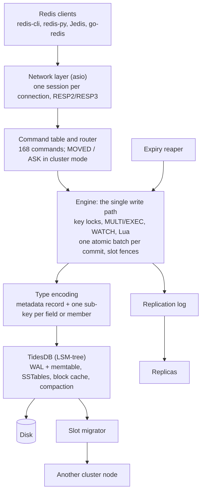

# TidesKV tutorial

TidesKV is a Redis 7.2-compatible server that keeps its data on disk in [TidesDB](https://github.com/tidesdb/tidesdb), an LSM-tree storage engine. Any Redis client works unchanged, and the dataset can be larger than RAM.

This tutorial has two parts:

- [A guided demo](#part-1-guided-demo), five short acts that show TidesKV working end to end. It takes about 15 minutes, and every reply shown was checked against a TidesKV 0.1.0 server.
- [How TidesKV works](#part-2-how-tideskv-works): the architecture, the storage model, every supported command, and configuration.

## Contents

- [Part 1: guided demo](#part-1-guided-demo)
  - [Setup](#setup)
  - [Act 1: it speaks Redis](#act-1-it-speaks-redis)
  - [Act 2: transactions and scripts](#act-2-transactions-and-scripts)
  - [Act 3: pull the plug, keep the data](#act-3-pull-the-plug-keep-the-data)
  - [Act 4: replication](#act-4-replication)
  - [Act 5: cluster and live slot migration](#act-5-cluster-and-live-slot-migration)
  - [Clean up](#clean-up)
- [Part 2: how TidesKV works](#part-2-how-tideskv-works)
  - [Architecture](#architecture)
  - [Storage: Redis types on an LSM-tree](#storage-redis-types-on-an-lsm-tree)
  - [Durability](#durability)
  - [Expiry](#expiry)
  - [Replication](#replication)
  - [Cluster mode](#cluster-mode)
  - [Command reference](#command-reference)
  - [Configuration](#configuration)
  - [Observability](#observability)
  - [Using it from application code](#using-it-from-application-code)
  - [Differences from Redis](#differences-from-redis)
  - [Troubleshooting](#troubleshooting)

---

## Part 1: guided demo

### Setup

You need one terminal for each server and one for the client. The demo uses these ports:

| Port | Role |
|---|---|
| 6666 | master (TidesKV's default port, not Redis's 6379) |
| 6667 | replica |
| 7001, 7002 | cluster nodes |

1. Build the release binary. On Ubuntu 24.04:

   ```bash
   sudo apt-get install -y cmake ninja-build build-essential git liblz4-dev libzstd-dev redis-tools
   cmake --preset release
   cmake --build --preset release -j
   export TIDESKV=$PWD/build/release/src/tideskv-server
   ```

2. Start the server. `--sync-mode full` fsyncs every write before acknowledging it, which Act 3 relies on:

   ```bash
   mkdir -p /tmp/demo
   $TIDESKV --port 6666 --dir /tmp/demo/master --sync-mode full
   ```

3. In the client terminal, check that it answers:

   ```bash
   redis-cli -p 6666 PING          # PONG
   redis-cli -p 6666 INFO server   # version, uptime, process id
   ```

`redis-cli` comes from the `redis-tools` package. Without it, use the one in the Redis image:

```bash
alias redis-cli='docker run --rm -i --network host redis:7.2.5 redis-cli'
```

> **Talking point:** nothing here is TidesKV-specific. The stock Redis CLI connects, and so do redis-py, Jedis, go-redis and other Redis clients.

### Act 1: it speaks Redis

Open an interactive session with `redis-cli -p 6666` and type the commands below. The comments show the replies.

**Strings, counters and TTLs**

```
SET greeting hello                  # OK
GET greeting                        # "hello"
INCR page:views                     # 1
INCRBY page:views 10                # 11
SET session:42 alice EX 60          # OK  (expires in 60 s)
TTL session:42                      # 60, counting down
```

**Hashes: an object with fields**

```
HSET user:1 name Alice city Kyiv age 30   # 3
HGETALL user:1                            # age 30, city Kyiv, name Alice
HINCRBY user:1 age 1                      # 31
```

**Lists: a work queue**

```
RPUSH queue job1 job2 job3          # 3
LPOP queue                          # "job1"
LRANGE queue 0 -1                   # job2, job3
```

Blocking pops work too. In a second client, run `BLPOP jobs 0`. It waits until the first client runs `RPUSH jobs urgent`, then returns at once.

**Sets and sorted sets: tags and a leaderboard**

```
SADD tags db redis cpp                          # 3
SISMEMBER tags redis                            # 1
ZADD leaderboard 100 alice 85 bob 120 carol     # 3
ZRANGE leaderboard 0 -1 REV WITHSCORES          # carol 120, alice 100, bob 85
ZINCRBY leaderboard 50 bob                      # "135"
ZRANK leaderboard bob                           # 2  (now top of the board)
```

**Keyspace and protocol**

```
SCAN 0 MATCH user:* COUNT 100       # cursor 0, [user:1]
TYPE leaderboard                    # zset
DBSIZE                              # number of keys
SELECT 1                            # 16 databases, as in Redis
HELLO 3                             # switch this connection to RESP3
```

> **Talking point:** the replies follow Redis 7.2. In CI a differential test sends the same commands to TidesKV and to a real Redis 7.2 and compares the replies.

### Act 2: transactions and scripts

**MULTI / EXEC runs commands as one unit**

```
MULTI                 # OK
INCR counter          # QUEUED
INCR counter          # QUEUED
EXEC                  # 1, 2
```

**WATCH cancels a transaction if another client changed the key.** Use two clients, A and B:

```
A> SET balance 100
A> WATCH balance
A> MULTI
A> DECRBY balance 30          # QUEUED
B> SET balance 500            # another client changes it
A> EXEC                       # (nil)  the transaction was cancelled
A> GET balance                # "500"
```

**Lua scripts run atomically on the server.** This one is a rate limiter that allows 3 calls:

```
EVAL "local v = redis.call('INCR', KEYS[1]); if v > tonumber(ARGV[1]) then return redis.error_reply('rate limited') end; return v" 1 rl:alice 3
```

Run it four times. It returns 1, 2, 3, and then `(error) rate limited`. `SCRIPT LOAD` with `EVALSHA` caches a script by its SHA1, as in Redis.

> **Talking point:** scripts use Lua 5.1 with Redis's sandbox. A script that runs longer than `lua-time-limit` (5 s) makes other clients get `BUSY` until it finishes or `SCRIPT KILL` stops it.

### Act 3: pull the plug, keep the data

This is the strongest part of the demo. Redis keeps its data in RAM. TidesKV writes data to disk before acknowledging it.

1. Write a key. The server is running with `--sync-mode full`:

   ```bash
   redis-cli -p 6666 SET important saved-before-crash    # OK
   ```

2. Kill the server hard, so nothing gets a chance to flush. Only the master is running at this point:

   ```bash
   pkill -9 -x tideskv-server
   ```

3. Start it again on the same directory and read the data back:

   ```bash
   $TIDESKV --port 6666 --dir /tmp/demo/master --sync-mode full
   redis-cli -p 6666 GET important       # "saved-before-crash"
   redis-cli -p 6666 HGETALL user:1      # everything from Act 1 is still there
   redis-cli -p 6666 DBSIZE
   ```

> **Talking point:** `full` fsyncs every acknowledged write. The default, `interval`, fsyncs once a second and can lose up to the last second of writes. `none` leaves flushing to the OS. A crash test suite in CI kill -9s the server and checks that no acknowledged write is lost.

### Act 4: replication

1. Start a second, empty server as the replica, in a new terminal:

   ```bash
   $TIDESKV --port 6667 --dir /tmp/demo/replica
   ```

2. Point it at the master. It gets a full copy of the data, then follows every new write:

   ```bash
   redis-cli -p 6667 REPLICAOF 127.0.0.1 6666   # OK
   redis-cli -p 6667 ROLE                       # slave 127.0.0.1 6666 connected <offset>
   redis-cli -p 6667 GET greeting               # "hello"  (copied by the full sync)
   ```

3. A replica is read-only:

   ```bash
   redis-cli -p 6667 SET x 1     # (error) READONLY You can't write against a read only replica.
   ```

4. Write on the master and wait for the replica to confirm it:

   ```bash
   redis-cli -p 6666 SET live-update from-master   # OK
   redis-cli -p 6666 WAIT 1 1000                   # 1  (one replica has it)
   redis-cli -p 6667 GET live-update               # "from-master"
   redis-cli -p 6666 ROLE                          # master, with the replica and its offset
   redis-cli -p 6667 INFO replication              # master_link_status:up, offsets
   ```

5. Fail over by promoting the replica:

   ```bash
   redis-cli -p 6667 REPLICAOF NO ONE    # OK
   redis-cli -p 6667 ROLE                # master
   ```

> **Talking point:** after a short disconnect, a replica resumes from the master's backlog (1 GB by default) and does not need a full copy again. `min-replicas-to-write` makes the master refuse writes when too few replicas are healthy.

### Act 5: cluster and live slot migration

TidesKV nodes don't gossip with each other. A controller tells every node the topology. In production that is [kvrocks-controller](https://github.com/apache/kvrocks-controller); here you play the controller by hand.

1. Start two nodes in cluster mode, in two terminals:

   ```bash
   $TIDESKV --port 7001 --dir /tmp/demo/c1 --cluster-enabled yes
   $TIDESKV --port 7002 --dir /tmp/demo/c2 --cluster-enabled yes
   ```

2. Give each node a 40-character ID, then push the same topology to both. Node 1 owns slots 0–8191 and node 2 owns slots 8192–16383:

   ```bash
   N1=$(printf 'a%.0s' {1..40}); N2=$(printf 'b%.0s' {1..40})
   TOPO="$N1 127.0.0.1 7001 master - 0-8191"$'\n'"$N2 127.0.0.1 7002 master - 8192-16383"
   redis-cli -p 7001 CLUSTERX SETNODEID $N1
   redis-cli -p 7002 CLUSTERX SETNODEID $N2
   redis-cli -p 7001 CLUSTERX SETNODES "$TOPO" 1
   redis-cli -p 7002 CLUSTERX SETNODES "$TOPO" 1
   redis-cli -p 7001 CLUSTER INFO      # cluster_state:ok, 16384 slots assigned, 2 nodes
   redis-cli -p 7001 CLUSTER NODES
   ```

3. Keys are routed by hash slot, as in Redis Cluster:

   ```bash
   redis-cli -p 7001 CLUSTER KEYSLOT user:1     # 10778  (owned by node 2)
   redis-cli -p 7001 SET user:1 alice           # (error) MOVED 10778 127.0.0.1:7002
   redis-cli -c -p 7001 SET user:1 alice        # -c follows the redirect: OK
   redis-cli -p 7001 MSET user:1 x greeting y   # (error) CROSSSLOT
   redis-cli -p 7001 SET {user}:a 1             # OK  (hash tag {user} = slot 5474, node 1)
   ```

4. Move slot 5474 from node 1 to node 2 while it holds data:

   ```bash
   redis-cli -p 7001 CLUSTERX MIGRATE 5474 $N2
   redis-cli -p 7001 CLUSTER INFO | grep migrating   # migrating_state: success
   redis-cli -p 7001 CLUSTERX SETSLOT 5474 NODE $N2 2
   redis-cli -p 7002 CLUSTERX SETSLOT 5474 NODE $N2 2
   redis-cli -p 7001 GET {user}:a               # (error) MOVED 5474 127.0.0.1:7002
   redis-cli -p 7002 GET {user}:a               # "1"  (the data moved with the slot)
   redis-cli -p 7002 CLUSTER SLOTS
   ```

   The last number of `SETNODES` and `SETSLOT` is the topology version. Each change must raise it.

> **Talking point:** writes to the slot keep working during a migration. Only the final moment, when the source sends the last changes, is fenced with a short `TRYAGAIN`, and no acknowledged write is lost. Apache Kvrocks's own migration test suites run against TidesKV in CI.

### Clean up

Stop the servers with Ctrl+C (or `redis-cli -p <port> SHUTDOWN`), then remove the demo data:

```bash
rm -rf /tmp/demo
```

---

## Part 2: how TidesKV works

### Architecture

Every command goes down one path. The router checks it, and in cluster mode it also checks that this node owns the key's slot. The engine runs the command under key locks as one atomic batch, and TidesDB writes that batch to its write-ahead log and memtable.



The source code follows the same layers:

| Directory | Layer |
|---|---|
| `src/net`, `src/resp` | Networking and the RESP2/RESP3 parser and writer |
| `src/commands` | The command table, routing, and every command |
| `src/exec` | The engine: the write path, transactions, key locks, slot fences, replication log |
| `src/types`, `src/encoding` | Data types and their key/value encodings |
| `src/storage` | The `Storage` interface, with TidesDB and in-memory backends |
| `src/expire` | The background expiry reaper |
| `src/script` | Lua scripting |
| `src/repl` | Replication: full sync and PSYNC |
| `src/cluster`, `src/migrate` | Topology, slot routing, slot migration |

### Storage: Redis types on an LSM-tree

TidesDB is a log-structured merge-tree (LSM-tree) engine, the same family as RocksDB, which Apache Kvrocks uses.

**How a write reaches disk:**

1. The engine hands TidesDB one batch per command, or per `EXEC` or script.
2. TidesDB appends the batch to its write-ahead log (WAL) and inserts it into the memtable, a sorted structure in memory (`memtable-size`, 64 MB by default). The write is acknowledged.
3. A full memtable is flushed to disk as an immutable sorted file, an SSTable.
4. Background compaction merges SSTables into fewer, larger ones and drops overwritten or deleted entries.

**How a read finds data:** it checks the memtable first, then the SSTables from newest to oldest. Hot blocks stay in the block cache (`block-cache-size`, 4 GB by default). Data blocks are compressed with lz4 by default.

**What this design gives you:**

- Fast writes: a write is a log append plus an in-memory insert, never an in-place update on disk.
- Data larger than RAM: only the memtable and the cache live in memory.
- Cheap range scans: keys are stored sorted, so `SCAN`, `HGETALL`, `ZRANGE` and `LRANGE` read neighbouring entries.

**The trade-off:** compaction rewrites data more than once (write amplification), and a deleted key takes disk space until compaction removes it.

**The data model.** TidesDB stores only sorted byte keys and values. TidesKV keeps five column families, which are separate key spaces inside one TidesDB database:

| Column family | Key | Holds |
|---|---|---|
| `meta` | db, slot, key | One record per Redis key: type, TTL, size. A string's value is stored here too. |
| `subkey` | db, slot, object id, field | One entry per hash field, set member or list element |
| `zscore` | db, slot, object id, score, member | Sorted-set members ordered by score |
| `expire` | db, expiry time, slot, key | Keys with a TTL, ordered by when they expire |
| `replog` | sequence number | The replication log |

What follows from this layout:

- `HGET user:1 name` reads one `subkey` entry, not the whole hash, so large hashes, sets and sorted sets stay cheap.
- `ZRANGEBYSCORE` is a range scan over `zscore`, because scores are stored in an order-preserving encoding.
- The slot is in every key, so a cluster migration copies one slot with one prefix scan.
- Each collection has an object id in its sub-keys. `DEL` of a big hash removes all of its sub-keys with one range delete, not one delete per field. After `compaction-collection-deletes` (1000) such deletes, TidesKV compacts the `subkey` and `zscore` column families to reclaim the space.

### Durability

| `sync-mode` | When the WAL is fsynced | What a power loss can lose |
|---|---|---|
| `full` | Before every write is acknowledged | Nothing that was acknowledged |
| `interval` (default) | Every `sync-interval-us` (1 s) | Up to that interval of writes |
| `none` | When the OS decides | Whatever the OS had not flushed |

Use `full` for data you cannot lose, `interval` for most workloads, and `none` for caches and bulk loads. The mode is set at startup.

### Expiry

A key past its TTL is never returned: a read checks the TTL and treats an expired key as missing. A background reaper scans the `expire` column family in time order and deletes expired keys, so they don't take disk space forever.

### Replication

- A replica connects with `REPLICAOF host port`, or the `replicaof` setting at startup.
- A new or diverged replica gets a **full sync**: a logical snapshot streamed from the master.
- After that it follows the **replication log**: every committed batch, in commit order.
- After a short disconnect it resumes from the master's backlog (`repl-backlog-size`, 1 GB) without a new full sync. This is PSYNC2-style partial resync.
- `WAIT numreplicas timeout` returns how many replicas have acknowledged everything written so far.
- `min-replicas-to-write` and `min-replicas-max-lag` make the master refuse writes when too few replicas are healthy.
- `REPLICAOF NO ONE` promotes a replica to a master.

Replicas are read-only by default (`replica-read-only yes`).

### Cluster mode

- Start each node with `cluster-enabled yes`. This can only be set at startup.
- Keys map to 16384 hash slots, as in Redis Cluster. A `{hash tag}` in the key forces related keys into one slot.
- A controller pushes the topology to each node with `CLUSTERX SETNODEID` and `CLUSTERX SETNODES`. Nodes don't gossip. [kvrocks-controller](https://github.com/apache/kvrocks-controller) 1.3.0 can manage a TidesKV cluster.
- Redis Cluster clients work unchanged. They follow `MOVED` and `ASK` redirects and use `READONLY` to read from replicas.
- **Slot migration** (`CLUSTERX MIGRATE <slot|from-to> <target-node-id>`) works in four steps:
  1. The source streams the slot's data to the target.
  2. It fences writes to the slot for a moment (clients get `TRYAGAIN`) while it sends the last changes.
  3. The controller assigns the slot to the target with `CLUSTERX SETSLOT` or a new `SETNODES`.
  4. If anything fails, the target removes the half-imported data.

### Command reference

TidesKV 0.1.0 supports 168 commands. They behave as in Redis 7.2, so the [Redis command docs](https://redis.io/docs/latest/commands/) apply to each one. `COMMAND LIST` on a running server prints the exact set.

| Group | Use | Commands |
|---|---|---|
| Strings | Values, counters, substrings | APPEND, DECR, DECRBY, GET, GETDEL, GETEX, GETRANGE, GETSET, INCR, INCRBY, INCRBYFLOAT, LCS, MGET, MSET, MSETNX, PSETEX, SET, SETEX, SETNX, SETRANGE, STRLEN, SUBSTR |
| Expiry | Time to live on any key | EXPIRE, EXPIREAT, EXPIRETIME, PERSIST, PEXPIRE, PEXPIREAT, PEXPIRETIME, PTTL, TTL |
| Hashes | Objects with fields | HDEL, HEXISTS, HGET, HGETALL, HINCRBY, HINCRBYFLOAT, HKEYS, HLEN, HMGET, HMSET, HRANDFIELD, HSCAN, HSET, HSETNX, HSTRLEN, HVALS |
| Lists | Queues and stacks | LINDEX, LINSERT, LLEN, LMOVE, LMPOP, LPOP, LPOS, LPUSH, LPUSHX, LRANGE, LREM, LSET, LTRIM, RPOP, RPOPLPUSH, RPUSH, RPUSHX |
| Blocking lists | Wait for an element | BLMOVE, BLMPOP, BLPOP, BRPOP, BRPOPLPUSH |
| Sets | Unique members, set algebra | SADD, SCARD, SDIFF, SDIFFSTORE, SINTER, SINTERCARD, SINTERSTORE, SISMEMBER, SMEMBERS, SMISMEMBER, SMOVE, SPOP, SRANDMEMBER, SREM, SSCAN, SUNION, SUNIONSTORE |
| Sorted sets | Rankings by score | ZADD, ZCARD, ZCOUNT, ZDIFF, ZDIFFSTORE, ZINCRBY, ZINTER, ZINTERCARD, ZINTERSTORE, ZLEXCOUNT, ZMPOP, ZMSCORE, ZPOPMAX, ZPOPMIN, ZRANDMEMBER, ZRANGE, ZRANGEBYLEX, ZRANGEBYSCORE, ZRANGESTORE, ZRANK, ZREM, ZREMRANGEBYLEX, ZREMRANGEBYRANK, ZREMRANGEBYSCORE, ZREVRANGE, ZREVRANGEBYLEX, ZREVRANGEBYSCORE, ZREVRANK, ZSCAN, ZSCORE, ZUNION, ZUNIONSTORE |
| Blocking sorted sets | Wait for a member | BZMPOP, BZPOPMAX, BZPOPMIN |
| Keyspace | Keys of any type | DEL, EXISTS, KEYS, RANDOMKEY, RENAME, RENAMENX, SCAN, TYPE, UNLINK, DBSIZE, SELECT, FLUSHDB, FLUSHALL |
| Transactions | Atomic groups, optimistic locking | MULTI, EXEC, DISCARD, WATCH, UNWATCH |
| Scripting | Lua 5.1 on the server | EVAL, EVALSHA, EVAL_RO, EVALSHA_RO, SCRIPT LOAD / EXISTS / FLUSH / KILL |
| Connection | Sessions and protocol | AUTH, CLIENT (ID, GETNAME, SETNAME, SETINFO, PAUSE, UNPAUSE), ECHO, HELLO, PING, QUIT, RESET |
| Server | Inspect and manage | COMMAND, CONFIG GET / SET, DEBUG, INFO, SHUTDOWN |
| Replication | Master and replicas | REPLICAOF, SLAVEOF, ROLE, WAIT. PSYNC, SYNC and REPLCONF are used between servers. |
| Cluster | Routing and topology | CLUSTER (INFO, NODES, SLOTS, SHARDS, KEYSLOT, MYID, COUNTKEYSINSLOT, GETKEYSINSLOT, …), CLUSTERX (SETNODEID, SETNODES, SETSLOT, MIGRATE), READONLY, READWRITE, ASKING |

### Configuration

Settings are read in this order, and later sources win:

1. A config file, one `name value` per line, as in Redis: `tideskv-server tideskv.conf`.
2. The `TIDESKV_REQUIREPASS` environment variable.
3. Command-line pairs: `--port 6380 --dir /var/lib/tideskv`.

`CONFIG GET *` lists every setting. `CONFIG SET` changes the ones marked runtime below. The others need a restart.

| Setting | Default | Runtime | Meaning |
|---|---|---|---|
| `bind` / `port` | `127.0.0.1` / `6666` | no | Listen address |
| `dir` | `./data` | no | Data directory |
| `workers` | `0` (one per CPU) | no | Worker threads |
| `sync-mode` | `interval` | no | `none`, `interval` or `full` |
| `sync-interval-us` | `1000000` | no | fsync period for `interval` |
| `block-cache-size` | `4gb` | no | TidesDB read cache |
| `memtable-size` | `64mb` | no | TidesDB write buffer |
| `l1-file-count-trigger` | `8` | no | Flush-tier tables per column family that start a merge |
| `l0-stall-threshold` | `64` | no | Write backpressure: throttle from half this backlog (unflushed memtables or flush-tier tables), block at it |
| `compression` | `lz4` | no | `no`, `lz4` or `zstd` |
| `requirepass` | empty | yes | Password for `AUTH` |
| `maxclients` | `10000` | yes | Connection limit |
| `lua-time-limit` | `5000` ms | yes | When a long script starts answering `BUSY` |
| `replicaof` | empty | no (use `REPLICAOF`) | `<host> <port>` to start as a replica |
| `repl-backlog-size` | `1gb` | yes | Backlog kept for partial resync |
| `repl-backlog-lazy` | `yes` | no | Keep no backlog until the first replica or slot migration needs one |
| `min-replicas-to-write` | `0` | yes | Refuse writes without enough healthy replicas |
| `cluster-enabled` | `no` | no | Cluster mode |

Replication and migration settings keep their Redis and Kvrocks names, such as `masterauth`, `replica-read-only`, `repl-timeout` and `migrate-batch-rate-limit-mb`.

Exit codes: 0 for a clean shutdown, 1 for a configuration error, 2 when storage fails to open, 3 when the server cannot listen.

### Observability

- `INFO` has the sections `server`, `clients`, `memory`, `stats`, `persistence`, `replication`, `cluster` and `keyspace`. Use `INFO replication` for the replication state and offsets.
- `ROLE` shows the role compactly, with each replica's offset on a master.
- `CLUSTER INFO` shows the cluster state and the progress of any slot migration (`migrating_slot(s)`, `migrating_state`).
- `DBSIZE` and `INFO keyspace` show key counts.

### Using it from application code

Use your usual Redis client. Only the port changes.

Python ([redis-py](https://github.com/redis/redis-py)):

```python
import redis

r = redis.Redis(host="127.0.0.1", port=6666, decode_responses=True)
r.set("greeting", "hello")
r.hset("user:1", mapping={"name": "Alice", "city": "Kyiv"})
print(r.get("greeting"), r.hgetall("user:1"))
```

Go ([go-redis](https://github.com/redis/go-redis)):

```go
rdb := redis.NewClient(&redis.Options{Addr: "127.0.0.1:6666"})
rdb.Set(ctx, "greeting", "hello", 0)
val, err := rdb.Get(ctx, "greeting").Result()
```

For cluster mode, use your client's cluster mode, such as `redis.RedisCluster` or `redis.NewClusterClient`, and give it any node's address.

### Differences from Redis

- **Not supported yet** (planned for v1.x): Streams, Bitmaps, HyperLogLog, Geo, Pub/Sub, JSON, Search, TLS, ACLs, and the commands `MOVE`, `COPY`, `SWAPDB`, `OBJECT` and `CLIENT LIST`.
- **On-disk format:** TidesKV cannot read Redis RDB files or a Kvrocks data directory, and won't. Move data through a client instead. The project is pre-1.0, so the on-disk format may still change between versions.
- **Default port** is 6666, not 6379.
- **Memory:** there is no `maxmemory` or eviction, because data lives on disk. Memory use is governed by `block-cache-size` and `memtable-size`.

### Troubleshooting

| Symptom | Cause and fix |
|---|---|
| `Could not connect to Redis at 127.0.0.1:6379` | redis-cli uses port 6379 by default. Add `-p 6666`. |
| The server exits with code 3 | The port is already in use. Choose another with `--port`. |
| The server exits with code 2 | The data directory cannot be opened. It may be held by another server or not be writable. |
| `READONLY You can't write against a read only replica.` | You are writing to a replica. Write to the master, or promote it with `REPLICAOF NO ONE`. |
| `MOVED <slot> <host:port>` | In cluster mode the key lives on another node. Use `redis-cli -c` or a cluster-aware client. |
| `CROSSSLOT Keys in request don't hash to the same slot` | A multi-key command spans slots. Put a common `{hash tag}` in the keys. |
| `TRYAGAIN` | A slot migration is finishing. Retry after a moment. |
| `BUSY` | A Lua script ran past `lua-time-limit`. Wait, or run `SCRIPT KILL`. |
| `can't set immutable config` | That setting can only be changed with a restart. |
